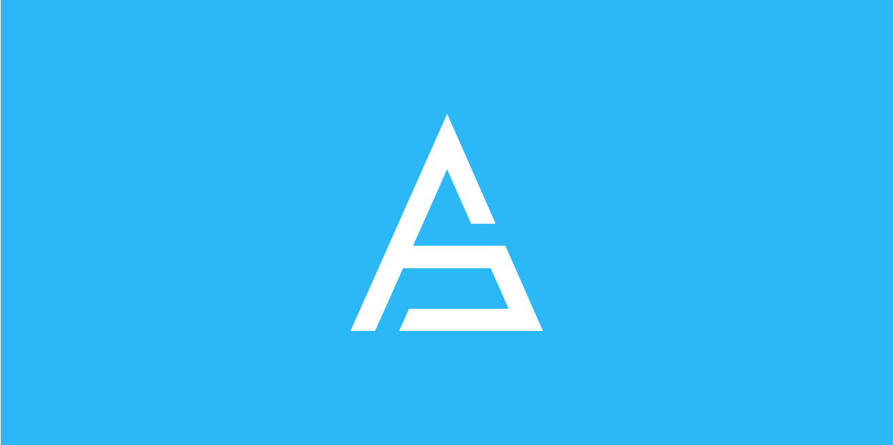

[](https://alan-sdk.github.io/alan.dart/)
[](https://github.com/alan-sdk/alan.dart/actions)
[](https://codecov.io/gh/alan-sdk/alan.dart/branch/main)
[](https://pub.dev/packages/alan)
[](https://github.com/cosmos/cosmos-sdk/releases)
[](https://flutter.dev)
[](https://github.com/alan-sdk/alan.dart/blob/main/LICENSE)

Alan.dart is a pure Dart package allowing you to easily integrate your Dart-based project with any [Cosmos](https://cosmos.network)-based blockchain.  

You can find the documentation on the [official website](https://alan-sdk.github.io/alan.dart/). 

## Cosmos-SDK compatibility table
Over time, we developed different versions of this library to be compatible with multiple Cosmos SDK releases. Following you can find the compatibility table that indicates which version you should use: 

|      Cosmos SDK version(s)      | Alan.dart version | 
|:-------------------------------:|:-----------------:|
| `v0.40.x`, `v0.41.x`, `v0.42.x` |     `v0.40.x`     |
|            `v0.45.x`            |     `v0.41.x`     |

## Regenerating the protobuf bindings

The qadena proto directory is a **required parameter**. Nothing about the surrounding directory
layout is assumed, so this works from any checkout location:

```bash
./scripts/generate_proto.sh \
    --qadena-src ../../qv3/proto/qadena \
    --qadena-only \
    --require-msg MsgUpdateCredential
```

| flag | meaning |
|---|---|
| `--qadena-src <path>` | **required** — path to the qadena proto directory (must contain `qadena/tx.proto`). May also be given as the `QADENA_SRC` env var. |
| `--qadena-only` | regenerate only the qadena protos |
| `--all` | also re-download the Cosmos SDK, gogoproto, googleapis, cosmos-proto, evm and wasmd protos |
| `--require-msg <name>` | refuse to run unless `<name>` appears in `qadena/tx.proto` |

**Use `--require-msg` when generating bindings for a new chain feature.** Pointing at a chain
checkout that predates the messages you need is otherwise silent: the script succeeds and emits Dart
that compiles and is simply missing them, and the problem only surfaces much later as an unresolved
symbol in application code. `--require-msg MsgUpdateCredential` turns that into an immediate,
explicit failure.

Requires `protoc` and the Dart plugin (`protoc-gen-dart`) on `PATH`.

Afterwards, `scripts/generate_exports.sh` runs automatically to refresh `lib/proto/export.dart`.

## Getting started
To start using this library inside your project, just edit your `pubspec.yml` file adding the following lines: 

```yaml
dependencies:
  alan: <version>
```

The latest available version is:  


You can even use a specific GitHub tag or branch if you want: 

```yaml
dependencies:
  alan:
    git:
      url: git://github.com/alan-sdk/alan.dart.git
      ref: <branch or tag>
```
